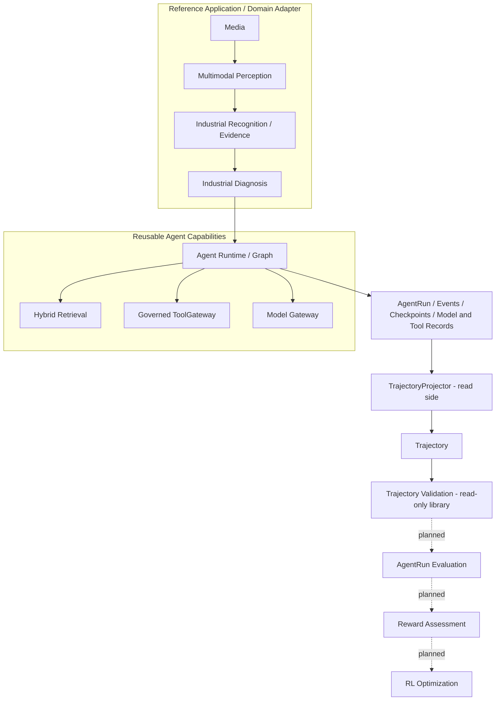

# 通用 Multimodal Agent Harness / Agent Learning Infrastructure

**建设中。** 当前项目提供 Agent 执行、记录、perception、检索、受治理工具调用和模型追踪能力，并以 Industrial Diagnosis 作为现有 Reference Application。Trajectory Projection MVP 与只读 Trajectory Validation 已实现；AgentRun Evaluation、Reward Assessment 和 RL 优化链路仍属后续计划。

项目由“cpp辅导的阿甘”开发。第三方、上游和既有贡献的权利以各自声明及 Git 历史为准；本署名不替代许可证。[pyproject.toml](pyproject.toml) 当前声明为 `Proprietary`。

## Current Project Direction

项目分阶段演进：

| 阶段 | 方向 |
|---|---|
| Phase 0 | Industrial Agent application |
| Phase 1 | Deindustrialization：清理领域流程耦合，保留可复用 Agent capability 与领域 Reference Application |
| Phase 2 | Agent Learning Infrastructure：使 Agent execution 可观察、可记录、可评价，并为后续优化建立基础 |

Phase 1 的详细验收结论见[历史验收记录](docs/deindustrialization_phase1_final_acceptance.md)。该文档保存阶段快照，不是当前架构规范。

## Current Capabilities

### Agent Runtime

- 有预算约束的 graph execution；当前节点机制包含 prepare、retrieve、decide、tool、finish。
- `AgentRun` 与有序 `AgentEvent` 持久化。
- 带 graph version 和 checksum 的 checkpoint；图转换与事件可原子记录。
- 运行状态管理以及当前 Diagnosis 应用中的有界执行和 resume 路径。

### Multimodal and Evidence

- Perception 接口处理 OCR、VLM visual findings、QR、ASR 和视频观察。
- Industrial Recognition adapter 持有领域 finding、人工确认及 `EvidenceBundle` 语义。
- Evidence provenance 将确认后的结果连接到来源、媒体及诊断引用。

### Retrieval and Tools

- `HybridRetriever` 使用授权、版本、有效窗口和 generic applicability 过滤知识。
- 共享 `ToolGateway` 实现工具校验、授权、限流、调用和审计。
- Industrial Diagnosis 当前使用只读 catalog：`asset.get`、`warranty.get`、`parts.availability`、`schedule.availability`、`work_orders.history`。

### Model and Evaluation Infrastructure

- `ModelInferenceRecord` 保留模型 release、manifest、prompt/context hash、响应 hash 和 token 等推理追踪信息。
- 仓库有模型生命周期、evaluation 与 training 组件；它们不等同于 AgentRun trajectory evaluation。
- 现有 PPO/GRPO/training modules are not yet connected to AgentRun Trajectory as a proven Agentic RL loop.

### Agent Learning Infrastructure

| 能力 | 状态 | 说明 |
|---|---|---|
| Trajectory Projection MVP | **Implemented** | 只读查询 AgentRun、事件、checkpoint、模型和工具记录，投影为内存中的 Trajectory。 |
| Trajectory Validation | **Implemented** | 纯内存、只读 library；检查投影轨迹的结构与记录绑定，不是自动 production pipeline、运行评测或训练资格判定。 |
| AgentRun Evaluation connected to new Trajectory | **Planned** | 尚无消费新 Trajectory 的运行评测链路。 |
| Reward Assessment connected to new Trajectory | **Planned** | 尚无关联该 Trajectory 的 reward 评价链路。 |
| Agentic RL optimization loop | **Planned** | 尚无从 AgentRun trajectory 到策略改进的已证实闭环。 |

TrajectoryProjector 是 read-side projection，不参与 graph execution，也不负责验证、计算 reward 或训练。投影输出仍受当前 Agent event/node 约定及已有记录完整度限制。

## Architecture Overview



Industrial Diagnosis and its adapters own business context, evidence authorization, diagnosis contracts, citations, and domain-specific result interpretation. The generic capability layer owns reusable execution, record projection, and structural trajectory validation. Maintenance Planning remains an optional retained reference-domain capability; it is disabled by default and is not a verified generic-core feature.

The projector reads existing persistence records and returns a Trajectory view. The validator consumes that in-memory view and does not alter runtime state or create a production pipeline. AgentRun Evaluation, Reward Assessment, and RL Optimization remain planned, not implemented links.

## Reference Application: Industrial Diagnosis

The current Reference Application exercises this path:

```text
Media
→ Multimodal Perception
→ Industrial Recognition / Evidence confirmation
→ Diagnosis context
→ Agent Runtime
→ Hybrid Retrieval / read-only tools
→ DiagnosisReport with citations
```

This application demonstrates how a domain adapter uses reusable capabilities. It does not define the identity of the whole project, and it does not establish multi-domain Agent reuse as already proven.

## Enterprise Tool Configuration

Enterprise Tool Integration is optional. `IOAP_ENTERPRISE_TOOLS_ENABLED` defaults to
`false` in Settings, the local Compose configuration, and the application Helm values.
In this state, API and workflow-worker composition do not construct an enterprise adapter
or read its token. The five enterprise read-only tools are absent from the registered and
model-visible Diagnosis catalogs. The existing `FINAL → finish` contract remains available.

To enable the integration, set `IOAP_ENTERPRISE_TOOLS_ENABLED=true`, configure
`IOAP_ENTERPRISE_TOOL_GATEWAY_URL`, and supply `IOAP_ENTERPRISE_TOOL_GATEWAY_TOKEN`
through the configured SecretProvider. Missing configuration stops startup. AUTO selects
the real HTTP adapter; MCP retains its additional configuration requirements.

The portfolio environment uses the disabled configuration.
`ENTERPRISE_TOOL_INTEGRATION=NOT_RUN`; no external enterprise invocation has been verified.

## Documentation

| Topic | Document |
|---|---|
| Current project direction | [Project Direction](docs/project_direction.md) |
| Current architecture | [Current Architecture](docs/current_architecture.md) |
| Generic/domain ownership rules | [Architecture Boundary](docs/architecture_boundary.md) |
| Agentic RL direction and status | [Agentic RL Architecture](docs/agentic_rl_architecture.md) |
| Current project acceptance | [Project Final Acceptance](docs/project_final_acceptance.md) |
| Phase 1 historical acceptance | [Phase 1 Final Acceptance](docs/deindustrialization_phase1_final_acceptance.md) |
| Documentation audit | [Project Direction Audit](docs/project_direction_audit.md) |

Batch reports, audits, plans, and migration records describe the phase in which they were created. Use the current architecture and direction documents for present-state descriptions; historical documents are not current architecture specifications.

## Local Verification

The repository includes a deterministic service-level Golden Path smoke:

```powershell
$env:PYTHONPATH = "src"
.venv\Scripts\python.exe scripts\deindustrialization_batch1_golden_path_smoke.py
```

This exercises a synthetic Agent flow and persistence path. It does not demonstrate a full production deployment, real model quality, or an Agentic RL loop.

## Source Map

| Capability | Main code area |
|---|---|
| Agent graph, events and checkpoints | `src/industrial_ops_agent/agent/` |
| Trajectory projection | `src/industrial_ops_agent/agent/trajectory.py` |
| Generic perception | `src/industrial_ops_agent/multimodal/` |
| Recognition and evidence domain adapter | `src/industrial_ops_agent/industrial_recognition/` and `application/incidents.py` |
| Knowledge and retrieval | `src/industrial_ops_agent/knowledge/` |
| Tool contracts and Gateway | `src/industrial_ops_agent/tools/` |
| Persistence models | `src/industrial_ops_agent/persistence/models.py` |
| Model inference tracking | `src/industrial_ops_agent/model_gateway/` |
| Industrial Diagnosis application | `src/industrial_ops_agent/application/`, `agent/diagnosis_runtime.py`, `orchestration/` |
