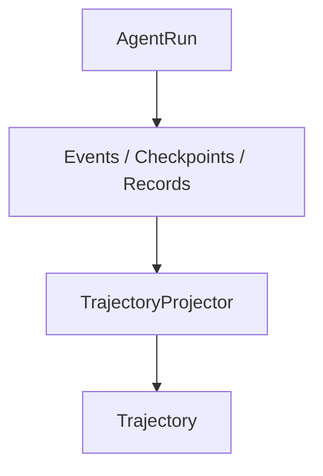

# Current Architecture

更新日期：2026-10-10。本文依据当前源码描述已实现架构。当前项目方向为建设中的通用 Agent Harness / Agent Learning Infrastructure，Industrial Diagnosis 是现有 reference application。

本文使用 **Implemented / In Progress / Planned** 区分状态。除明确标为后续工作项的内容，下列架构层均已有代码；源码存在不等于任意应用复用或完整部署验收已经通过。

## Agent Runtime Layer

状态：**Implemented**。

| 组件 | 当前实现与职责 |
|---|---|
| AgentRun | [AgentRunRecord](../src/industrial_ops_agent/persistence/models.py)提供 `agent_run_id`、状态、预算、最后序号与版本。当前创建入口包括 `DiagnosisService` 和 `AgentRunControlService`；应用服务创建运行，再派发工作流。 |
| AgentEvent | [AgentEventStore](../src/industrial_ops_agent/agent/events.py)按运行追加带 ID、sequence、type、payload、visibility 和时间的事件。数据库约束保证同租户同运行的事件序号唯一。 |
| Graph execution | [AgentGraph](../src/industrial_ops_agent/agent/graph.py)实现有预算约束的图机制，通过 `AgentGraphRuntime` 和调用者提供的 `AgentGraphDefinition` 执行。现有节点为 prepare、retrieve、decide、tool、finish。 |
| Checkpoint | [AgentCheckpointStore](../src/industrial_ops_agent/agent/checkpoints.py)保存 state、graph version 与 checksum；`advance()` 在同一事务中追加事件并保存同序号检查点，检查 expected sequence。 |

现有生产路径由 [DiagnosisActivity](../src/industrial_ops_agent/orchestration/workflows.py)构造 `AgentGraph(DiagnosisRuntime(...), DIAGNOSIS_GRAPH_DEFINITION)`。Temporal 负责工作流调度与重试，图负责节点执行；现有领域运行实现位于 [diagnosis_runtime.py](../src/industrial_ops_agent/agent/diagnosis_runtime.py)。通用图机制与领域运行实现的 ownership 不由同一个 `agent/` 目录名决定。

## Context and Evidence Layer

状态：**Implemented**。

[MultimodalProcessor](../src/industrial_ops_agent/multimodal/processor.py)接收 [PerceptionRequest](../src/industrial_ops_agent/multimodal/models.py)，输出 `PerceptionResult`。其中包括 OCR、visual findings、QR、ASR 和视频观察，以及 processor versions；perception core 不负责工业资产绑定、人工确认或 EvidenceBundle ownership。

[RecognitionService](../src/industrial_ops_agent/application/incidents.py)和 [Industrial Recognition](../src/industrial_ops_agent/industrial_recognition/evidence.py)负责工业识别语义、EvidenceBundle、持久化与确认。[DiagnosisEvidenceResolver](../src/industrial_ops_agent/industrial_recognition/diagnosis_evidence.py)依 Diagnosis manifest 的 evidence refs 读取确认后的持久化 finding，并核对版本与 hash，转换为 [AgentEvidenceContext](../src/industrial_ops_agent/agent/evidence.py)。

当前 provenance 链通过 bundle/version、recognition result、原 finding 的 source ID、media reference、source hash 和 result hash 连接诊断引用与原始感知结果。这些字段由领域 adapter 解释；通用记录不自行推导工业确认状态。

[HybridRetriever](../src/industrial_ops_agent/knowledge/retrieval.py)使用 tenant、ACL、版本/有效窗口与 [generic applicability](../src/industrial_ops_agent/knowledge/applicability.py)过滤并返回 evidence 和 guard trace。工业 device family/model 的筛选含义由领域侧转换。`DiagnosisRuntime` 将知识与 recognition evidence 合并到运行上下文，并将已选择 evidence 和 guard 保存在 checkpoint。现有记录不能据此恢复完整检索候选、淘汰过程与所有排名细节。

## Action Layer

状态：**Implemented**。

[ToolGateway](../src/industrial_ops_agent/tools/gateway.py)提供 registry/schema 校验、授权、限流、只读 adapter 调用及事实审计。现有 Diagnosis catalog 由 [tool_catalog.py](../src/industrial_ops_agent/agent/tool_catalog.py)定义，经 [diagnosis_composition.py](../src/industrial_ops_agent/tools/diagnosis_composition.py)装配到共享 Gateway 实现。

Enterprise Tool Integration 由 `Settings.enterprise_tools_enabled` 显式控制，环境变量为
`IOAP_ENTERPRISE_TOOLS_ENABLED`，默认关闭。关闭状态下，API 与 workflow worker 使用空的
企业工具目录，不构造企业 adapter，不读取企业 token，也不要求企业 endpoint。
`DiagnosisRuntime` 根据 Gateway 实际注册目录及运行 manifest 的版本绑定选择模型可见工具。
既有 `FINAL → finish` 路径仍然有效。

开启状态注册 `asset.get`、`warranty.get`、`parts.availability`、`schedule.availability` 和
`work_orders.history` 五个 reference application 只读工具。必须配置
`IOAP_ENTERPRISE_TOOL_GATEWAY_URL`，由正式 SecretProvider 提供
`IOAP_ENTERPRISE_TOOL_GATEWAY_TOKEN`；缺少配置立即终止启动。API 和 worker 共用只读
adapter factory；AUTO 使用真实 HTTP adapter，MCP 保持其额外配置要求。

Portfolio 环境采用关闭配置，`ENTERPRISE_TOOL_INTEGRATION=NOT_RUN`。外部企业调用尚未验证。

`ToolCallRecord` 保存 tool call ID、可选 AgentRun ID、工具 ID/版本、risk tier、status、input digest 和 output metadata。它不保存完整输入参数及完整工具返回值；runtime 在 checkpoint 中保存有界 tool facts/failures。授权、schema 或限流边界的失败可能尚未产生可关联的 ToolCallRecord，投影须保留数据缺口。

## Model Layer

状态：**Implemented**。

[Model Gateway](../src/industrial_ops_agent/model_gateway/service.py)与 [ModelInferenceRecord](../src/industrial_ops_agent/persistence/models.py)记录推理身份和版本绑定。记录包含 inference request ID、model alias、resolved release ID、manifest hash、prompt/context hash、response JSON/hash、token 使用及执行状态；还可关联 AgentRun。

当前 `EnvironmentAwareModelResolver` 只解析已发布的生产 release。仓库仍没有候选模型评测专用 resolver 或受治理的 VLM evaluation execution path，因此候选模型尚不能通过 Model Gateway 在发布前完成正式评测。真实本地 Qwen3-VL endpoint 目前只通过独立诊断探针验证，尚未连接到 Model Gateway。

`OpenAiCompatibleTransport` 现有明确的 `IOAP_MODEL_GATEWAY_AUTH_MODE` 配置：`none` 不读取模型 API 密钥，也不发送 Authorization；`bearer` 要求 SecretProvider 提供密钥。此传输合同已通过本地代码验证；候选 release 生命周期和真实 Gateway 推理仍未完成。

现有 persistence record 同时保留可选 `diagnosis_run_id` 等应用关联字段。该兼容存储字段不表示所有模型调用都属于 Agent trajectory；当前 Projector 只读取关联目标 AgentRun 的推理记录。

## Learning Infrastructure Layer

状态：**Trajectory Projection MVP — Implemented**。

[TrajectoryProjector](../src/industrial_ops_agent/agent/trajectory.py)通过 `project(context, agent_run_id)`执行租户限定的查询，汇集 AgentEvent、AgentCheckpoint、ModelInferenceRecord 和 ToolCallRecord，返回内存中的 `Trajectory`。这是 **read-side projection**；它读取执行产物，不执行 graph、模型、检索或工具，也不写入 trajectory 数据表。

投影目前识别已有 `graph_started`、`model_started`、`graph_node_started/completed` 事件约定；从 decide、retrieve、tool 完成事件形成 `MODEL_DECISION`、`RETRIEVAL`、`TOOL` 步骤。模型 observation 来自同一 inference 的 model-started checkpoint 中的 `pending_request`；模型响应、checkpoint ID/sequence/checksum 与工具调用 ID用于关联已有记录。

结果保留既有 action/result JSON、模型版本与 response hash、工具元数据、run status 和终态事件。`gaps` 表示部分无法恢复的数据，不能视为独立 Trajectory Validation。当前 projector 依赖既有节点/事件约定，不承诺投影任意 graph、所有重试尝试或完整环境回放。

[Projector 测试](../tests/agent/test_trajectory_projection.py)覆盖生产 persistence models 上的投影、工具记录缺失与 model-started observation 关联；Phase 2A.2 Validation 测试覆盖持久化记录投影后的结构检查。最终验收重跑了这些 focused tests，但未执行完整产品部署。

[TrajectoryValidator](../src/industrial_ops_agent/agent/trajectory_validation.py)以显式调用方式消费内存中的 `Trajectory`，只读检查 `STRUCTURE`、`OBSERVATION_BINDING`、`ACTION_BINDING`、`RESULT_BINDING` 和 `TERMINAL` 五类完整性。它返回 quality、issues 与 `evaluation_eligible`，不查询数据库、不修改 Trajectory、不自动运行，也不判断业务正确性、reward 或训练资格；当前没有自动 production trajectory pipeline。

| 后续能力 | 状态 | 现有实现边界 |
|---|---|---|
| Trajectory Validation | Implemented | 纯内存、只读 library；显式验证投影结果，不是自动 runtime/production pipeline。 |
| AgentRun Evaluation | Planned | 尚未建立消费该 Trajectory 的评测链路。 |
| Reward Assessment | Planned | 尚未建立该 Trajectory 的 reward 评估。 |
| RL optimization loop | Planned | 尚未连接 trajectory 数据与策略改进。 |

## Domain Application Layer

状态：**Industrial Diagnosis reference application — Implemented**。

Industrial Diagnosis 拥有业务输入、资产上下文、Recognition/EvidenceBundle、Diagnosis manifest、诊断 prompt/action/report 契约及报告引用语义。它通过 adapter 使用通用 perception、retrieval、ToolGateway、Model Gateway 和图机制。

Maintenance Planning 是 optional retained reference-domain capability，其 API、workflow、runtime binding 与 records 保留在领域侧；`multi_agent_planning_enabled` 默认 `false`。它不属于 generic core，也未作为完整 council E2E 能力通过本次验收；不能根据当前 Diagnosis AgentRun 轨迹推定其 council 执行已纳入同一轨迹容器。

[runtime.py](../src/industrial_ops_agent/runtime.py)、工作流 runner 与 [orchestration/entrypoint.py](../src/industrial_ops_agent/orchestration/entrypoint.py)承担显式应用装配。领域 evaluator、domain reward 和人类反馈解释在新的 Trajectory 学习链路中均为 **Planned**，ownership 规则见 [Architecture Boundary](architecture_boundary.md)。

Plant Disease Diagnosis 已有 PlantDoc 数据导入器与候选清单检查流程。当前候选清单包含 600 张图片、2,130 个原始边界框及 29 个原始类别；来源仍待提交审核，数据尚未形成正式 GOLD evaluation suite。Evaluation Suite 与 Evaluation Policy 已有提交、独立审核、摘要绑定和审核记录合同，审核决定仍须由独立身份提交。Plant Disease diagnosis runtime、正式 evaluation、候选模型发布前评测、release、deployment 和 Portfolio Demo 尚未验收。

当前 Portfolio Demo 验收状态、正式审核合同和数据准备检查见 [Plant Disease Portfolio Demo](plant_disease_portfolio_demo.md)。

公开 evaluation source 的提交与审核由 [public_source.py](../src/industrial_ops_agent/evaluation/public_source.py)执行；审核需要 `MODEL_RELEASE_APPROVER` 权限，提交人与审核人的 `subject_id` 必须不同。Suite 与 Policy 注册后处于 `DRAFT`，提交后进入 `SUBMITTED`；审核决定绑定提交时摘要并记录独立审核人、理由和时间。审核通过后，Suite 进入 `FROZEN`，Policy 进入 `ACTIVE`。当前正式评测快照仍依赖已有数据集快照和工业数据整理来源，尚不支持直接消费 PlantDoc public source。
